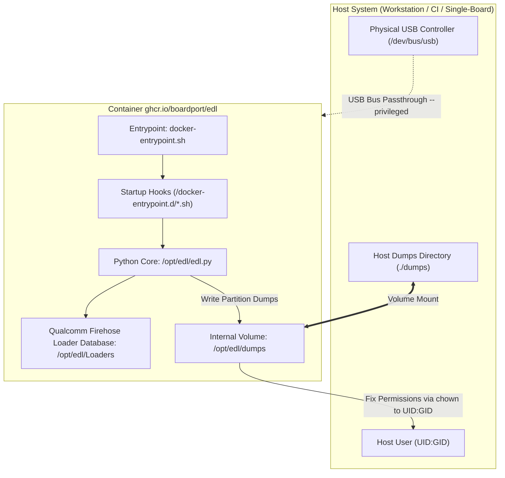

# 🏛️ Architecture and System Design: EDL Container

This document outlines the internal architecture of the `edl-container` repository, the containerization strategy for `bkerler/edl`,
hardware-level USB communication with Qualcomm devices, and the architectural role of this component within the **BoardPort** ecosystem.

---

## 🎯 Purpose and Context within BoardPort

The **BoardPort** initiative is dedicated to porting modern Linux kernels, lightweight operating systems, and bootloaders to diverse
hardware platforms: low-cost 4G USB modems (MSM8916/MSM8909), embedded development boards, and legacy smartphones.

During initial device probing, memory extraction, and low-level recovery, access to non-volatile storage (EMMC/UFS) through the
emergency service mode **Qualcomm Emergency Download Mode (EDL / 9008)** is critical.

**EDL Container** delivers a reproducible, fully isolated, and turnkey environment for these low-level flashing operations without
requiring manual setup of Python virtual environments, native build toolchains, or USB driver tweaks on developer workstations.

---

## 📁 Repository Structure

```text
edl-container/
├── .(gemini|claude)/               # Optional AI context directories (gitignored)
├── .github/                        # GitHub configuration and CI/CD pipelines
│   ├── ISSUE_TEMPLATE/             # Standardized issue templates (Bug report, Feature request)
│   ├── PULL_REQUEST_TEMPLATE/      # Pull request description templates
│   ├── workflows/                  # GitHub Actions automation (linters, multi-arch builds)
│   ├── CONTRIBUTING(_RU).md        # Contribution guidelines and coding conventions
│   ├── SECURITY(_RU).md            # Security policy and vulnerability reporting
│   └── SUPPORT(_RU).md             # Community support channels
├── .make/                          # Modular GNU Make scripts
│   ├── docker.mk                   # System-wide Docker CLI operations
│   ├── docker_edl.mk               # Project Docker image build workflows
│   ├── edl.mk                      # Autonomous EDL commands via Docker run
│   └── git.mk                      # Common Git workflow automation
├── docker/                         # Containerization source files
│   ├── Dockerfile.debian           # Debian Slim container build recipe
│   └── docker-entrypoint.sh        # Entrypoint script with permission normalization
├── .dockerignore                   # Docker build context exclusion rules
├── .editorconfig                   # Consistent editor formatting rules
├── .gitignore                      # Git version control exclusions
├── .markdownlint-cli2.jsonc        # Markdown linting configuration
├── ARCHITECTURE.md                 # System architecture overview (current document)
├── ARCHITECTURE_RU.md              # System architecture overview (Russian version)
├── LICENSE                         # Project license terms (MIT)
├── Makefile                        # Root orchestrator and entry point for Make targets
├── README.md                       # Main project landing page (English)
└── README_RU.md                    # Main project landing page (Russian)
```

---

## 🧱 Container Architecture

The container image is built on top of **Debian 12 (Bookworm) Slim** paired with **Python 3.11**:



### Core Image Components

1. **System Dependencies:**
   - `libusb-1.0-0` and `liblzma-dev` — native libraries for raw USB bulk transfers and compressed image processing;
   - `adb` and `fastboot` — auxiliary utilities for transitioning target devices into EDL mode from recovery or bootloader;
   - `git` — utilized during build phase to recursively fetch the upstream loader database submodules.
2. **Upstream `bkerler/edl` Codebase:**
   - Pinned to stable release tags (default: `3.52.1`);
   - Installed with all runtime dependencies (cryptography engines, partition table parsers for GPT/MBR, USB drivers);
   - Bundles a comprehensive collection of pre-indexed Firehose/NPRG programmers for diverse Qualcomm SoCs.
3. **Application Directory Isolation:**
   - The application codebase resides in `/opt/edl`;
   - Output artifacts and memory dumps are directed to `/opt/edl/dumps`.

---

## ⚙️ Operating Principle and Execution Lifecycle

Execution is routed through the `docker-entrypoint.sh` wrapper script:

1. **Environment Initialization Phase:**
   - The script sets default paths for `EDL_DIR` (`/opt/edl`) and `EDL_DUMP_DIR` (`/opt/edl/dumps`).
   - It checks for user-defined startup scripts in `/docker-entrypoint.d`. Any executable `*.sh` files found are
     executed in alphabetical order before starting the main process.
2. **Command Dispatch Phase:**
   - Ensures the output directory exists (`mkdir -p "$EDL_DUMP_DIR"`).
   - Forwards all arguments directly to `python /opt/edl/edl.py "$@"`.
3. **Permission Post-Processing Phase:**
   - Upon process completion, the container executes `chown -R "${EDL_DUMP_UID}:${EDL_DUMP_UID}" "$EDL_DUMP_DIR"`.
   - This ensures all newly created partition dumps and log files remain readable and writable by the host user
     without requiring `sudo`.

---

## 🔌 Hardware Layer and USB Communication

Interacting with the target hardware requires:

1. **Privileged Mode:** The `--privileged` flag grants access to kernel device nodes and necessary cgroup subsystems.
2. **USB Bus Passthrough:** Mounting `-v /dev/bus/usb:/dev/bus/usb` exposes the physical host USB bus directly to the container.
3. **Host Kernel Conflict Mitigation:**
   - The Linux kernel module `qcserial` binds automatically to USB devices matching VID:PID `05c6:9008`, creating modem TTY endpoints.
   - For raw Sahara/Firehose protocol communication, `edl` requires exclusive access to USB bulk endpoints.
   - Architectural resolution: unloading the driver via `rmmod qcserial` or configuring a udev rule to prevent binding.

---

## 🛡️ Security and Permissions Model (UID/GID)

Containerized developer tools frequently generate files owned by `root`, complicating subsequent editing or cleanup on the host.

This repository implements a non-intrusive ownership mapping model:

- `EDL_DUMP_UID` and `EDL_DUMP_GID` environment variables are passed at invocation (`-e EDL_DUMP_UID=$(id -u)`);
- The entrypoint normalizes file ownership within the mounted dump volume upon completion;
- The container exposes zero listening network services and does not require outbound network access during flashing operations.

---

## 🔄 Build and Distribution Pipeline (CI/CD)

1. **Multi-Architecture Support:**
   - Container images are built for both `linux/amd64` (standard x86_64 workstations and servers) and `linux/arm64`
     (Raspberry Pi / Orange Pi flashing rigs, Apple Silicon workstations).
2. **Package Registry:**
   - Official images are published to the GitHub Container Registry: `ghcr.io/boardport/edl`.
3. **Semantic Versioning:**
   - Automated tagging provides `latest` (tracking `main`), release versions `vX.Y.Z`, and upstream version tags `3.52.1`.
