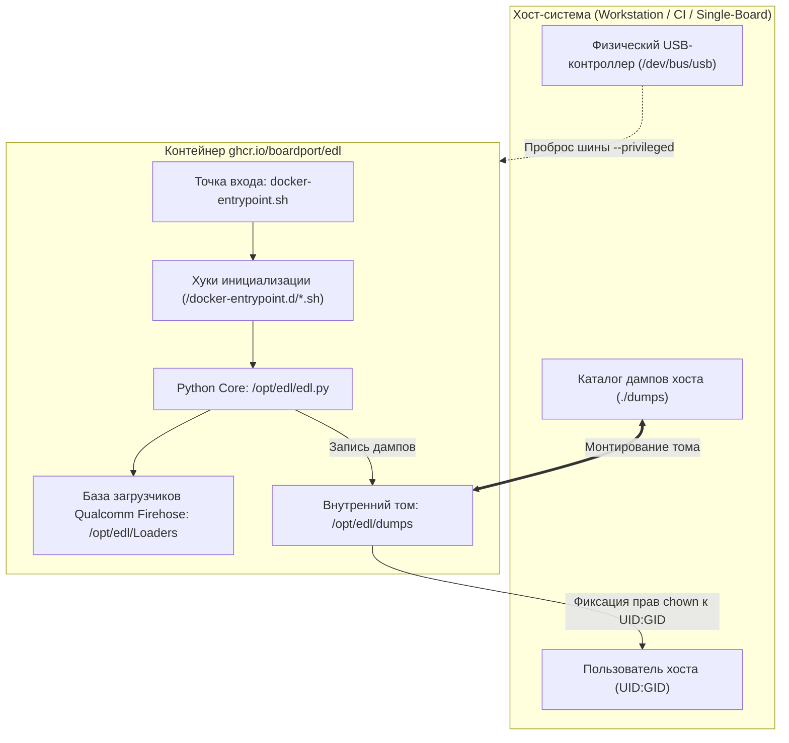

# 🏛️ Архитектура и устройство проекта EDL Container

Документ описывает внутреннее устройство репозитория `edl-container`, принципы контейнеризации утилиты `bkerler/edl`,
аппаратное взаимодействие с устройствами Qualcomm и архитектурную роль компонента в экосистеме **BoardPort**.

---

## 🎯 Назначение и контекст в экосистеме BoardPort

Проект **BoardPort** нацелен на оживление и адаптацию современных версий Linux-ядер, легковесных дистрибутивов и загрузчиков
для широкого круга оборудования: китайских 4G USB-модемов (MSM8916/MSM8909), плат разработки и устаревших смартфонов.

На этапе первоначального анализа и прошивки ключевым звеном является доступ к памяти устройства (EMMC/UFS) в аварийном режиме
**Qualcomm Emergency Download Mode (EDL / 9008)**.

**EDL Container** решает задачу предоставления воспроизводимой, изолированной и готовой к немедленному использованию среды
для низкоуровневых операций без необходимости ручной настройки Python-окружения, компиляторов и драйверов на рабочей станции.

---

## 📁 Структура репозитория

```text
edl-container/
├── .(gemini|claude)/               # Дополнительные каталоги AI-контекста (в .gitignore)
├── .github/                        # Конфигурация GitHub и CI/CD
│   ├── ISSUE_TEMPLATE/             # Шаблоны создания задач (Bug report, Feature request)
│   ├── PULL_REQUEST_TEMPLATE/      # Шаблоны описания Pull Request
│   ├── workflows/                  # Пайплайны GitHub Actions (линтеры, multi-arch сборка)
│   ├── CONTRIBUTING(_RU).md        # Регламент внесения изменений
│   ├── SECURITY(_RU).md            # Политика безопасности и сообщений об уязвимостях
│   └── SUPPORT(_RU).md             # Каналы поддержки сообщества
├── .make/                          # Модульные сценарии GNU Make
│   ├── docker.mk                   # Базовые системные операции Docker
│   ├── docker_edl.mk               # Сценарии локальной сборки Docker-образа
│   ├── edl.mk                      # Автономные команды EDL через Docker run
│   └── git.mk                      # Автоматизация типовых Git-операций
├── docker/                         # Конфигурация контейнеризации
│   ├── Dockerfile.debian           # Рецепт сборки образа на базе Debian Slim
│   └── docker-entrypoint.sh        # Скрипт точки входа и нормализации прав
├── .dockerignore                   # Исключения контекста сборки Docker
├── .editorconfig                   # Соглашения о форматировании кода
├── .gitignore                      # Исключения версионного контроля Git
├── .markdownlint-cli2.jsonc        # Правила проверки Markdown-документации
├── ARCHITECTURE.md                 # Описание архитектуры (английская версия)
├── ARCHITECTURE_RU.md              # Описание архитектуры (текущий документ)
├── LICENSE                         # Текст лицензии проекта (MIT)
├── Makefile                        # Корневой диспетчер Make-команд
├── README.md                       # Главная страница проекта (English)
└── README_RU.md                    # Главная страница проекта (Russian)
```

---

## 🧱 Базовая архитектура контейнера

Контейнер построен вокруг легковесного дистрибутива **Debian 12 (Bookworm) Slim** с интерпретатором **Python 3.11**:



### Ключевые компоненты образа

1. **Системные зависимости:**
   - `libusb-1.0-0` и `liblzma-dev` — системные библиотеки для прямого USB-ввода/вывода и распаковки сжатых образов;
   - `adb` и `fastboot` — вспомогательные утилиты для перевода устройств в режим EDL из recovery/bootloader;
   - `git` — используется на этапе сборки для рекурсивного клонирования сабмодулей загрузчиков.
2. **Апстрим `bkerler/edl`:**
   - Фиксируется на релизном теге (по умолчанию `3.52.1`);
   - Устанавливается со всеми зависимостями (библиотеки криптографии, парсеры разметки GPT/MBR, USB-транспорт);
   - Включает предустановленную базу загрузчиков Firehose/NPRG для различных чипсетов Qualcomm.
3. **Изоляция каталога приложения:**
   - Исходный код утилиты расположен в `/opt/edl`;
   - Выходной каталог дампов изолирован по пути `/opt/edl/dumps`.

---

## ⚙️ Принцип работы и жизненный цикл выполнения

Вызов контейнера происходит через скрипт-обертку `docker-entrypoint.sh`:

1. **Фаза инициализации окружения:**
   - Скрипт считывает переменные `EDL_DIR` (по умолчанию `/opt/edl`) и `EDL_DUMP_DIR` (`/opt/edl/dumps`).
   - Проверяется наличие каталога пользовательских хуков `/docker-entrypoint.d`. Если в каталоге присутствуют
     исполняемые `*.sh` файлы, они выполняются по алфавитному порядку перед запуском утилиты.
2. **Фаза исполнения команды:**
   - Гарантируется существование каталога дампов (`mkdir -p "$EDL_DUMP_DIR"`).
   - Все входящие аргументы передаются в `python /opt/edl/edl.py "$@"`.
3. **Фаза пост-обработки прав доступа:**
   - После завершения работы утилиты контейнер выполняет `chown -R "${EDL_DUMP_UID}:${EDL_DUMP_UID}" "$EDL_DUMP_DIR"`.
   - Это гарантирует, что созданные файлы образов разделов и дампов памяти будут доступны для чтения и редактирования
     пользователем хоста без использования `sudo`.

---

## 🔌 Аппаратный уровень и взаимодействие с USB

Для работы с шиной USB контейнер требует:

1. **Режима привилегий:** Флаг `--privileged` обеспечивает доступ к узлам устройств ядра и подсистеме cgroups.
2. **Монтирования контроллера USB:** Том `-v /dev/bus/usb:/dev/bus/usb` пробрасывает физическую шину внутрь контейнера.
3. **Разрешения конфликтов с ядром хоста:**
   - Модуль ядра `qcserial` автоматически перехватывает устройства с VID:PID `05c6:9008` и регистрирует их как модемные TTY-порты.
   - Для прямого взаимодействия через протокол Sahara/Firehose утилите требуется монопольный доступ к USB bulk endpoints.
   - Архитектурное решение: предварительная выгрузка `rmmod qcserial` или udev-правило с маскированием порта.

---

## 🛡️ Безопасность и модель разрешений (UID/GID)

Контейнеризированные инструменты часто создают артефакты от имени пользователя `root`, что блокирует их дальнейшую обработку
на хост-машине без повышения привилегий.

В проекте реализована прозрачная схема сопоставления прав:

- Переменные `EDL_DUMP_UID` и `EDL_DUMP_GID` передаются при старте контейнера (`-e EDL_DUMP_UID=$(id -u)`);
- Точка входа нормализует владельца созданных файлов в смонтированном каталоге дампов;
- Базовый образ не содержит уязвимых демонов или открытых сетевых портов (сетевой стек по умолчанию не требуется для прошивки).

---

## 🔄 Процессы сборки и публикации (CI/CD)

1. **Кросс-платформенность (Multi-Arch):**
   - Образы собираются под две целевые архитектуры: `linux/amd64` (рабочие станции x86_64) и `linux/arm64`
     (одноплатники Raspberry Pi / Orange Pi, а также рабочие места на Apple Silicon).
2. **Реестр пакетов:**
   - Официальные образы публикуются в GitHub Container Registry: `ghcr.io/boardport/edl`.
3. **Семантическое версионирование:**
   - Публикация тегов `latest` (ветка `main`), версий релиза `vX.Y.Z` и версий апстрима `3.52.1`.
