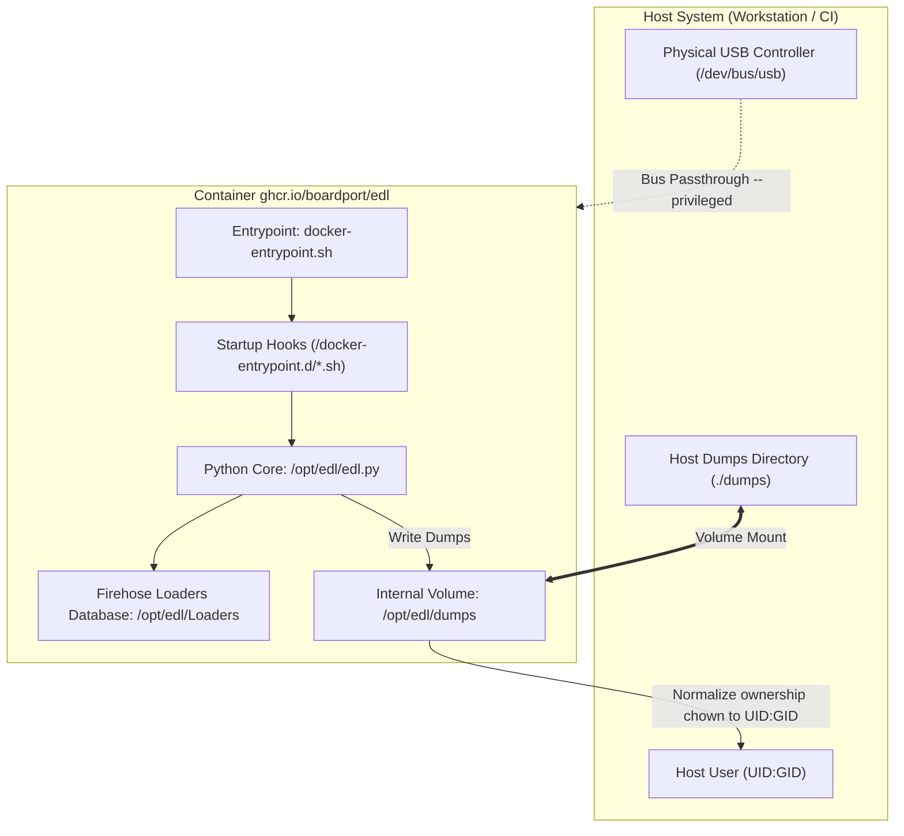

# System Architecture

Technical specification of container internals, encapsulation design for `bkerler/edl`,
hardware-level USB controller interaction, and the file permission model.

---

## Architectural Principles and Boundaries

The primary architectural goal is isolating low-level build and runtime dependencies from the host system
while preserving transparent access to physical USB hardware and host storage:

1. **Hardware Passthrough:** The container accesses the host USB controller directly without virtualization layers.
2. **Filesystem Transparency:** Output artifacts (partition dumps, log files, disk images) are written to the host
   filesystem with unprivileged host user ownership without requiring `sudo`.
3. **Execution Portability:** Invocations work seamlessly through the modular GNU Make runner or directly via standard `docker run`.

---

## Repository Structure

```text
edl-container/
├── .github/                        # GitHub Actions workflows (linters, multi-arch builds)
├── .make/                          # Modular GNU Make scripts (edl.mk, edl_docker.mk)
├── docker/                         # Containerization assets (Dockerfile, entrypoint)
├── docs/                           # Project documentation and knowledge base (Markdown)
├── .dockerignore                   # Docker build context exclusions
├── .editorconfig                   # Code style definitions
├── .gitignore                      # Git version control exclusions
├── .markdownlint-cli2.jsonc        # Markdownlint configuration
├── LICENSE                         # Project license (MIT)
├── Makefile                        # Root Make dispatcher
├── README.md                       # Repository landing page (English)
└── README_RU.md                    # Repository landing page (Russian)
```

---

## Container Internals

The container is built upon a minimal **Debian 12 (Bookworm) Slim** base image with **Python 3.11**:



### Image Layers

1. **System Layer:**
   - `libusb-1.0-0` and `liblzma-dev` — system libraries for raw USB bulk I/O and fast compressed image extraction.
   - `adb` and `fastboot` — tools for programmatic device mode switching.
   - `git` and `build-essential` — build dependencies for native cryptographic modules.
2. **Tool Core (`bkerler/edl`):**
   - Installed with all required packages (cryptography, GPT/MBR partition table parsers, USB transport).
   - Bundles an extensive library of Qualcomm Firehose and NPRG programmer binaries organized by SoC family.
3. **Directory Isolation:**
   - Source code and binaries reside in `/opt/edl`.
   - Output artifacts are routed to `/opt/edl/dumps`.

---

## Execution Lifecycle (`docker-entrypoint.sh`)

Container execution follows a deterministic lifecycle:

1. **Environment Initialization:**
   - Reads `EDL_DIR` (`/opt/edl`), `EDL_DUMP_DIR` (`/opt/edl/dumps`), and `EDL_DUMP_UID` (default `1000`).
   - If `/docker-entrypoint.d` is mounted, executable `*.sh` scripts run in alphabetical order.
2. **Routing and Execution:**
   - Ensures the output dump directory exists (`mkdir -p "$EDL_DUMP_DIR"`).
   - Standard shell binaries (`bash`, `sh`, `adb`, `fastboot`, `python`) execute via `exec "$@"`.
   - All other commands route to `python /opt/edl/edl.py "$@"`.
3. **Permission Normalization:**
   - Upon completion, the entrypoint executes:
     `chown -R "${EDL_DUMP_UID}:${EDL_DUMP_UID}" "$EDL_DUMP_DIR"`.
   - Created files remain readable and writable by the host user without elevated privileges.

---

## Hardware Layer and USB Passthrough

Direct communication with Qualcomm hardware requires:

1. **`--privileged` Flag:** Grants access to host kernel device nodes, sysfs, and cgroups.
2. **`/dev/bus/usb` Volume Mount:** Exposes the physical host USB bus topology inside the container.
3. **Resolving `qcserial` Conflicts:**
   - The Linux kernel driver `qcserial` automatically binds to VID:PID `05c6:9008` as a TTY serial device (`/dev/ttyUSB*`).
   - Sahara and Firehose protocols require exclusive control of raw bulk endpoints via `libusb`.
   - Resolution: Unload the kernel driver (`rmmod qcserial`) or blacklist it via modprobe/udev.

---

## Security Model

- **Minimal Network Surface:** Flashing operations require no internet connectivity. No background network daemons are exposed.
- **Filesystem Isolation:** The container only accesses mounted paths (the physical USB bus and the output dump directory).
  The host root filesystem remains isolated.

---

## Build and Release Pipelines (CI/CD)

- **Multi-Architecture Support:** Images are compiled for `linux/amd64` (x86_64) and `linux/arm64` (ARM64 boards, Apple Silicon).
- **Container Registry:** Automated releases publish to GitHub Container Registry: `ghcr.io/boardport/edl`.
- **Versioning Scheme:** Supports `latest` (from `main`), semantic tags `vX.Y.Z`, and upstream version tags.
