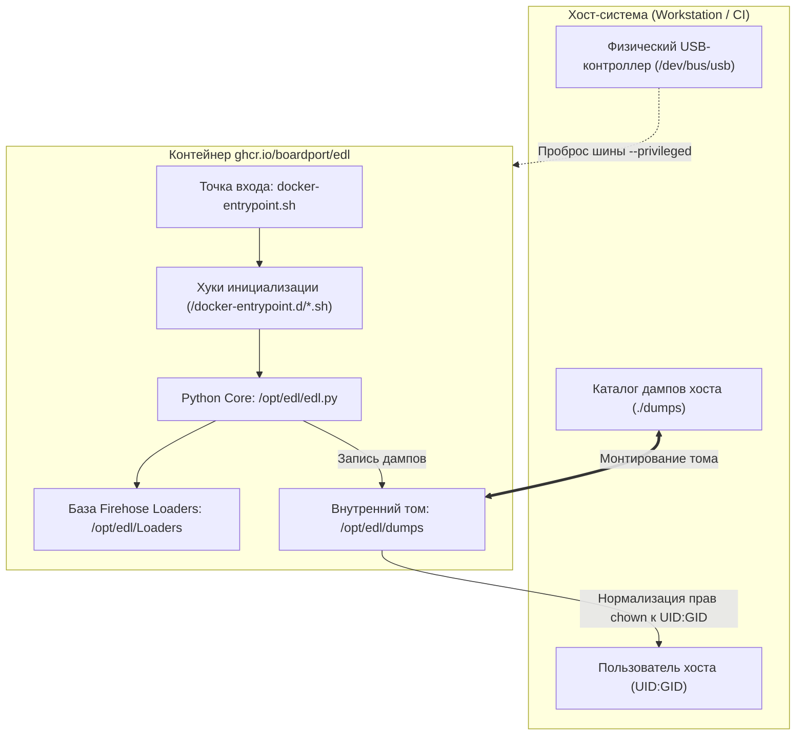

# Архитектура решения

Техническая спецификация внутреннего устройства контейнера, принципы инкапсуляции утилиты `bkerler/edl`,
аппаратное взаимодействие с контроллером USB и модель разграничения прав доступа.

---

## Архитектурные границы и принципы

Основная задача архитектуры — изолировать низкоуровневые системные зависимости и сборку C-библиотек от хост-системы,
сохранив при этом прозрачный доступ к физическим USB-устройствам и локальной файловой системе хоста:

1. **Аппаратная прозрачность:** контейнер получает прямой доступ к USB-контроллеру хоста без эмуляции или виртуализации.
2. **Прозрачность файловой системы:** результаты работы (дампы разделов, логи, бинарные образы) сохраняются на хосте
   с правами текущего пользователя без использования `sudo`.
3. **Автономность запуска:** контейнер запускается через легковесную Make-обертку либо напрямую через стандартизированный `docker run`.

---

## Структура репозитория

```text
edl-container/
├── .github/                        # Автоматизация GitHub Actions (линтеры, multi-arch сборка)
├── .make/                          # Модульные сценарии GNU Make (edl.mk, edl_docker.mk)
├── docker/                         # Конфигурация контейнеризации (Dockerfile, entrypoint)
├── docs/                           # Документация и база знаний проекта (Markdown)
├── .dockerignore                   # Исключения контекста сборки Docker
├── .editorconfig                   # Соглашения о форматировании кода
├── .gitignore                      # Исключения версионного контроля Git
├── .markdownlint-cli2.jsonc        # Правила проверки Markdown-документации
├── LICENSE                         # Текст лицензии проекта (MIT)
├── Makefile                        # Диспетчер Make-команд
├── README.md                       # Главная страница проекта (English)
└── README_RU.md                    # Главная страница проекта (Russian)
```

---

## Внутреннее устройство контейнера

Контейнер построен вокруг минималистичного базового образа **Debian 12 (Bookworm) Slim** с интерпретатором **Python 3.11**:



### Компоненты образа

1. **Системный уровень:**
   - `libusb-1.0-0` и `liblzma-dev` — системные библиотеки для прямого USB-ввода/вывода и быстрой распаковки сжатых образов;
   - `adb` и `fastboot` — вспомогательные инструменты для перевода устройств в режим EDL программным путем;
   - `git` и `build-essential` — используются на этапе сборки для сборки C-модулей и загрузки репозиториев.
2. **Ядро утилиты (`bkerler/edl`):**
   - Устанавливается со всеми зависимостями (криптография, парсеры разметки GPT/MBR, USB-транспорт);
   - Содержит встроенную структурированную базу программаторов Firehose/NPRG, рассортированную по чипсетам.
3. **Изоляция каталогов:**
   - Исходный код и исполняемые файлы расположены в `/opt/edl`;
   - Каталог выгрузки изолирован в `/opt/edl/dumps`.

---

## Жизненный цикл выполнения (`docker-entrypoint.sh`)

Запуск контейнера управляется оркестратором точки входа:

1. **Инициализация окружения:**
   - Считываются переменные `EDL_DIR` (`/opt/edl`), `EDL_DUMP_DIR` (`/opt/edl/dumps`) и `EDL_DUMP_UID` (по умолчанию `1000`).
   - Если смонтирован каталог `/docker-entrypoint.d`, в алфавитном порядке выполняются пользовательские исполняемые скрипты `*.sh`.
2. **Маршрутизация и исполнение:**
   - Создается каталог для дампов (`mkdir -p "$EDL_DUMP_DIR"`).
   - Системные оболочки и утилиты (`bash`, `sh`, `adb`, `fastboot`, `python`) исполняются напрямую через `exec "$@"`.
   - Команды `edl` передаются главному скрипту: `python /opt/edl/edl.py "$@"`.
3. **Пост-обработка прав доступа:**
   - После завершения выполнения команды точка входа вызывает:
     `chown -R "${EDL_DUMP_UID}:${EDL_DUMP_UID}" "$EDL_DUMP_DIR"`.
   - Созданные файлы гарантированно принадлежат пользователю хоста, запустившему команду.

---

## Аппаратное взаимодействие с USB-шиной

Для прямого управления контроллером USB контейнеру требуются следующие параметры запуска:

1. **Флаг `--privileged`:** предоставляет контейнеру доступ к подсистемам ядра, узлам устройств и cgroups.
2. **Монтирование `/dev/bus/usb`:** передает структуру физической шины хоста внутрь контейнера.
3. **Разрешение конфликта с `qcserial`:**
   - Модуль ядра хоста `qcserial` автоматически перехватывает устройства с VID:PID `05c6:9008` как модемные порты (`/dev/ttyUSB*`).
   - Протоколам Sahara и Firehose необходим монопольный доступ к USB bulk endpoints через `libusb`.
   - Решение: предварительная выгрузка драйвера на хосте (`rmmod qcserial`) или маскирование через правила udev / blacklist.

---

## Модель безопасности

- **Минимальный сетевой периметр:** контейнеру не требуется доступ в глобальную сеть во время штатных операций прошивки.
  Сетевые порты не открываются и не прослушиваются.
- **Безопасность хоста:** контейнер имеет доступ только к проброшенным путям (физический USB-контроллер и рабочий каталог дампов).
  Файловая система хоста изолирована.

---

## Процессы сборки и публикации (CI/CD)

- **Многоплатформенность (Multi-Arch):** образы автоматически собираются под две архитектуры:
  `linux/amd64` (x86_64) и `linux/arm64` (ARM64 одноплатники и рабочие станции).
- **Реестр образов:** релизы публикуются в GitHub Container Registry: `ghcr.io/boardport/edl`.
- **Версионирование:** поддерживаются теги `latest` (ветка `main`), семантические версии `vX.Y.Z` и версионные теги апстрима.
